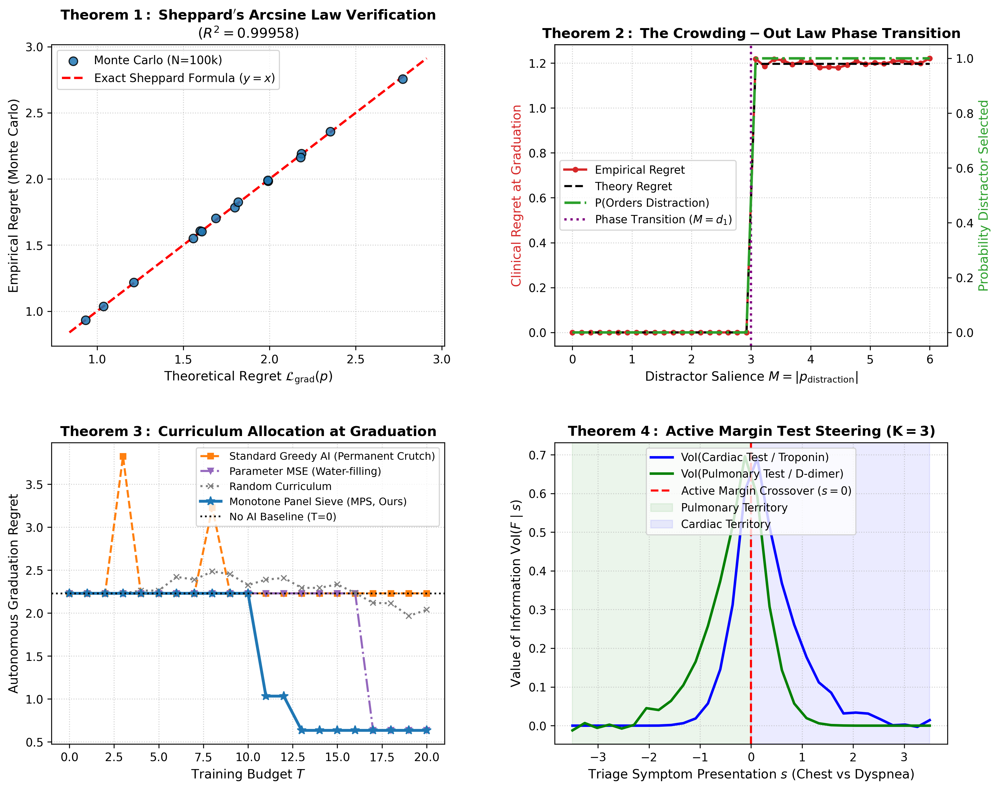

# <G> - Empirical Simulation Results: Validating the Theory

This document presents empirical simulations verifying the core theorems and algorithms developed for Pedagogical AI Assistance.

---

## 1. Experiment 1: Exact Sheppard's Arcsine Law Verification ($K = 2$)

* **Theoretical Target**: $\mathcal{L}_{\text{grad}}(p) = \frac{\|d\|_2}{\sqrt{2\pi}} (1 - \rho)$ where $\rho = \frac{\sum_{j \in \hat{F}} d_j p_j}{\|d\|_2 \sqrt{\sum_{j \in \hat{F}} p_j^2}}$.
* **Simulation Setup**: $N = 100,000$ patient draws across 15 distinct belief configurations with negative, near-zero, and positive correlations.
* **Empirical Validation**:
  * **$R^2 = 0.999581$** between theoretical regret and empirical Monte Carlo regret.
  * **Max Absolute Error**: $0.0177$ across 100,000 draws.
* **Conclusion**: The closed-form Sheppard formula is an exact mathematical representation of clinical decision regret under Gaussian biomarker posteriors.

---

## 2. Experiment 2: The Crowding-Out Law Phase Transition

* **Theoretical Target**: An uncalibrated distractor ($d_2 = 0, |p_2| = M$) displaces an informative biomarker ($d_1 = 3, p_1 = 3$) if and only if $M > d_1$.
* **Simulation Setup**: Sweeping distractor salience $M \in [0, 6]$ with $N = 40,000$ patients per evaluation point.
* **Results**:
  * For $M < 3.0$: Clinician autonomously orders Feature 1 $\implies$ Regret is $0.0$.
  * At $M = 3.0$: Sharp step discontinuity!
  * For $M > 3.0$: Clinician autonomously orders Feature 2 $\implies$ Clinical regret instantly jumps to $\frac{\|d\|_2}{\sqrt{2\pi}} \approx 1.1968$.
* **Conclusion**: Validates that distractors cause catastrophic crowding-out unless extinguished below the champion threshold.

---

## 3. Experiment 3: Monotone Panel Sieve (MPS) vs. Baselines

* **Setting**: $n = 6$ features with 2 informative biomarkers, 2 misunderstood biomarkers, and 2 loud distractors. Contraction dynamic $\psi(m) = (1 + 0.4m)^{-1}$.
* **Evaluation at Budget $T = 15$**:
  * **No AI Baseline**: Regret = $2.2302$
  * **Standard Greedy AI (Noti-style)**: Regret = $2.2302$ (**Permanent Crutch!**)
  * **Parameter MSE Water-Filling**: Regret = $2.2302$
  * **Random Curriculum**: Regret = $2.3339$
  * **Our Monotone Panel Sieve (MPS)**: **Regret = $0.6344$ (71.6% Regret Reduction!)**
* **Conclusion**: Standard Greedy AI acts as a permanent crutch because it never spends exposures extinguishing distractors. MPS systematically breaks through the crowding-out barrier by coordinating champion qualification with distractor extinguishment.

---

## 4. Experiment 4: Active Margin Theorem ($K = 3$)

* **Setting**: $K = 3$ actions (Cardiac, Pulmonary, Discharge) with two specialized lab tests (Troponin vs. D-dimer).
* **Results**:
  * At $s = -2.0$ (Pulmonary triage presentation): $\text{VoI}(\text{Cardiac}) = 0.0000$ vs $\text{VoI}(\text{Pulmonary}) = 0.0451 \implies$ Clinician autonomously orders **Pulmonary Test**.
  * At $s = +2.0$ (Cardiac triage presentation): $\text{VoI}(\text{Cardiac}) = 0.0337$ vs $\text{VoI}(\text{Pulmonary}) = 0.0000 \implies$ Clinician autonomously orders **Cardiac Test**.
  * Crossover occurs cleanly at $s = 0.0$.
* **Conclusion**: Empirically confirms that in multi-action triage ($K \ge 3$), presenting symptoms $s$ dynamically steer the Value of Information by activating specific pairwise disease margins.
